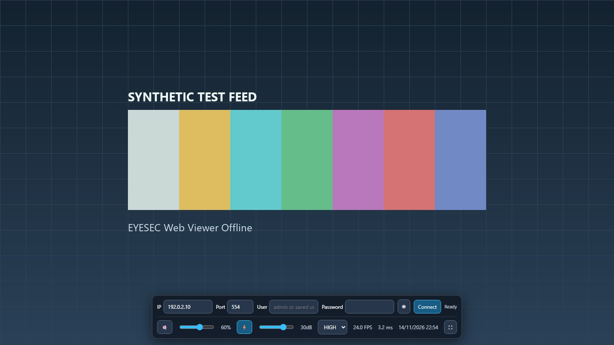

<div align="center">

# EYESEC Web Viewer Offline

**Watch a compatible EYESEC camera in your browser over your local Ethernet or Wi‑Fi network.**

[](https://www.python.org/)
[](https://flask.palletsprojects.com/)
[](https://ffmpeg.org/)

[Key Features](#-key-features) · [Screenshots](#-screenshots--ui-showcase) · [Architecture](#-technical-architecture) · [Getting Started](#-getting-started) · [Releases](https://github.com/thearticle/EYESEC-Web-Viewer-Offline/releases)

</div>

---

## 📖 Overview

EYESEC Web Viewer Offline is a local browser viewer for compatible EYESEC RTSP cameras. Once the camera and viewer are set up, the computer streams directly from the camera over the same LAN or Wi‑Fi. You can open the viewer even when the internet connection is down, as long as the local network is working.

## 🏠 Why View Locally?

For in-house monitoring, the video travels from the camera to your computer and browser without a vendor cloud relay. Skipping that round trip can reduce viewing delay, especially when the internet connection is slow or busy. Actual delay depends on the camera, network, stream quality, and buffering.

## ✨ Key Features

| Feature | How to use it |
| --- | --- |
| **Zoom in, zoom out, and pan** | Scroll over the image to zoom around the pointer. Drag while zoomed in, or double-click to reset. |
| **Live FPS and latency** | Read the decoded video frame rate and the time to open a TCP connection to the camera. |
| **Fullscreen** | Use the fullscreen button for a larger camera view. Move the pointer to reveal the controls after they hide. |
| **Editable camera connection** | Change the full IP address, RTSP port, username, and password in the browser. The port defaults to **554** and a new camera’s username defaults to **`admin`**. Enter the camera’s own password. |
| **HIGH and LOW video** | Select HIGH for detail or LOW for a lighter stream when available. |
| **Audio, volume, and boost** | Unmute the camera microphone, adjust playback volume, and enable gain when the feed is quiet. |

## 📱 Screenshots & UI Showcase



*Viewer on a synthetic test feed. The IP address is reserved for documentation.*


*Illustrated setup guide. Menu names and available options vary by camera model and firmware.*

## 🏗️ Technical Architecture

```text
EYESEC camera ── RTSP over Ethernet or Wi-Fi ── Viewer host ── HTTP loopback ── Browser
```

- **Video** uses headless OpenCV to read the camera’s HIGH or LOW RTSP stream and serves it as MJPEG.
- **Audio** uses FFmpeg to convert the HIGH stream’s audio track into browser-playable MP3 on demand.
- **Camera settings** stay on the viewer host. Windows DPAPI protects the saved password for the current Windows user. The page opens with a blank password field, even when the server can reuse the password.
- **Browser access** uses `127.0.0.1` on the viewer computer. The camera can be elsewhere on the same local network.

## 🛠️ Tech Stack

| Component | Technology |
| --- | --- |
| Local server | Python, Flask, Waitress |
| Video capture | OpenCV with FFmpeg backend |
| Audio transcoding | FFmpeg with libmp3lame |
| Browser controls | HTML, CSS, and JavaScript |

## 🚀 Getting Started

### Prerequisites

- A computer on the same local network as a camera that exposes the EYESEC RTSP stream paths.
- A 64-bit Python installation and a modern browser. The rebuild was tested with Python 3.14 on Windows.
- Live audio requires FFmpeg with `libmp3lame` on PATH. [FFmpeg downloads](https://ffmpeg.org/download.html)
- The camera’s local IP address and camera credentials. See the [EYESEC mobile app steps](docs/setup.md#find-the-camera-ip-and-set-its-password).

### Installation

Clone the repository and create a fresh virtual environment. On Windows, run these commands in PowerShell.

```powershell
git clone https://github.com/thearticle/EYESEC-Web-Viewer-Offline.git
cd EYESEC-Web-Viewer-Offline
python -m venv .venv
.\.venv\Scripts\python.exe -m pip install -r requirements.txt
.\.venv\Scripts\python.exe app.py
```

If an earlier installation already uses `.venv`, create this version’s environment in a new folder such as `venv` and use that folder in the commands. Starting with a fresh environment gives the viewer a single OpenCV package.

Open the local viewer at `http://127.0.0.1:5000`. Enter the full camera IP, the RTSP port (usually **554**), the camera username (often `admin`), and the camera password. Click **Connect** and wait for **Live**. [Setup and troubleshooting](docs/setup.md)

If port 5000 is in use, add `--port 5001` to the `app.py` command and open `http://127.0.0.1:5001`.

### Run the tests

```powershell
.\.venv\Scripts\python.exe -m pip check
.\.venv\Scripts\python.exe -m unittest discover -s tests -v
```

## 📂 Project Structure

| Path | Purpose |
| --- | --- |
| `app.py` | Local HTTP server and camera selection |
| `camera.py` | RTSP capture, FPS, and audio transcoding |
| `camera_settings.py` | Input validation and local settings storage |
| `templates/viewer.html`, `static/` | Browser controls and viewer layout |
| `requirements.txt` | Python dependencies |
| `tests/` | Camera settings and viewer endpoint tests |
| `docs/setup.md` | Camera setup and troubleshooting |
| `docs/images/` | Viewer screenshot and illustrated setup |

## 👨‍💻 Author & Credits

Created by [Fauzan Afianto](https://afianto.dev/). The README format follows [KuloWargi](https://github.com/thearticle/kulowargi-family-tree).
